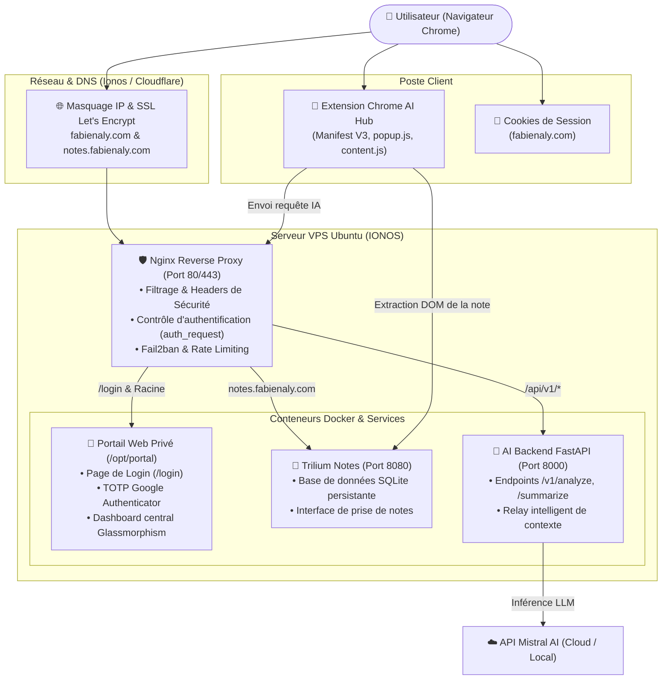
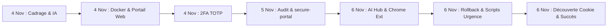

# 00. Projet Greta — Index Général et Retranscription Complète des Conversations

[01. Analyse & Intégration IA →](01_CONV_2026-11-04_ANALYSE_ET_INTEGRATION_IA_TRILIUM.md) | [10. Registre des Scripts](10_REGISTRE_SCRIPTS_ET_FICHIERS_DU_PROJET.md)

> [!IMPORTANT]
> **Projet :** Greta (Trilium Notes, Portail Sécurisé VPS, AI Hub & Extension Chrome)  
> **Auteur / Utilisateur :** Fabien (`Lulucarab664`)  
> **Période :** Du 4 novembre au 6 novembre 2026  
> **Nombre de conversations transcrites :** 4 sessions principales (76 échanges) + 5 sessions de sous-agents Browser.

## 🎯 Présentation du Projet
Ce dossier regroupe la **retranscription exhaustive et ordonnée** de toutes les sessions de travail réalisées pour concevoir, déployer, sécuriser et réparer l'infrastructure personnelle d'IA et de prise de notes de Fabien.

Le projet rassemble :
- Une instance **Trilium Notes** auto-hébergée sur VPS Ubuntu.
- Un **Portail Web d'accueil privé** sécurisé avec double authentification TOTP Google Authenticator.
- Un **AI Hub** (API backend FastAPI conteneurisée exploitant les modèles Mistral).
- Une **Extension Chrome Manifest V3** permettant d'analyser, résumer et créer des flashcards à partir des notes affichées à l'écran.
- Une collection de **12 scripts shell d'automatisation et de dépannage** garantissant la haute disponibilité et la reproductibilité du serveur.

---

## 📚 Sommaire des Fichiers de Retranscription

L'intégralité des échanges, décisions techniques, commandes shell et codes sources a été découpée de manière modulaire en **10 documents Markdown thématiques** :

| # | Fichier | Date | Description du contenu |
| :-: | :--- | :---: | :--- |
| **01** | [**01. Analyse & Intégration IA**](01_CONV_2026-11-04_ANALYSE_ET_INTEGRATION_IA_TRILIUM.md) | 04/11/2026 | Cadrage technique, réflexion sur les LLM locaux (Ollama, vLLM, Mistral) et faisabilité d'intégration dans Trilium Notes. |
| **02** | [**02. Migration VPS Docker Trilium**](02_CONV_2026-11-04_MIGRATION_VPS_DOCKER_TRILIUM.md) | 04/11/2026 | Guide Zero-to-Hero, déploiement Docker sur VPS Ubuntu vierge, gestion des ports 8080/8081 et volumes persistants. |
| **03** | [**03. Portail Web & Dashboard**](03_CONV_2026-11-04_CREATION_PORTAIL_ET_DASHBOARD_WEB.md) | 04/11/2026 | Protection IP via Cloudflare/Ionos, développement du portail web d'accueil sécurisé et script `install-portal.sh`. |
| **04** | [**04. Authentification 2FA TOTP & Mail**](04_CONV_2026-11-04_CONFIGURATION_TOTP_2FA_ET_MAIL.md) | 04/11/2026 | Échec de la récupération email IONOS, bascule vers Google Authenticator (TOTP), QR Codes SSH/Web et script `fix-portal.sh`. |
| **05** | [**05. Audit Sécurité & Durcissement**](05_CONV_2026-11-05_AUDIT_SECURITE_ET_DURCISSEMENT.md) | 05/11/2026 | Analyse de vulnérabilité sur `fabienaly.com`, Fail2ban, en-têtes HTTP stricts (CSP, HSTS) et script `secure-portal.sh`. |
| **06** | [**06. Architecture AI Hub & Extension Chrome**](06_CONV_2026-11-06_ARCHITECTURE_AI_HUB_ET_EXTENSION.md) | 06/11/2026 | Conception du Smart Context Relay, extension Chrome Manifest V3, backend FastAPI Docker avec Mistral et `install-ai-hub.sh`. |
| **07** | [**07. Dépannage Verrouillage & Rollback**](07_CONV_2026-11-06_DEPANNAGE_VERROUILLAGE_ET_ROLLBACK.md) | 06/11/2026 | Incident de lockout Nginx, diagnostic navigateur, création des scripts `rollback-portal.sh` et `lock-all-with-password.sh`. |
| **08** | [**08. Reset TOTP & Découverte Cookie**](08_CONV_2026-11-06_RESET_TOTP_AUTHENTIFICATION_MISTRAL.md) | 06/11/2026 | Découverte de la cause racine (cookie corrompu côté navigateur), déblocage immédiat et script `setup-portal-ai-mistral.sh`. |
| **09** | [**09. Rapports Sous-Agents Navigateur**](09_CONV_2026-11-06_SOUS_AGENTS_TESTS_NAVIGATEUR.md) | 06/11/2026 | Retranscription des 5 missions autonomes de diagnostic et de tests web en direct via Chrome DevTools MCP. |
| **10** | [**10. Registre des Scripts & Fichiers**](10_REGISTRE_SCRIPTS_ET_FICHIERS_DU_PROJET.md) | Référence | Guide technique complet des 12 scripts bash `.sh`, du Docker Compose, du backend FastAPI et de l'extension Chrome. |

---

## 🗺️ Cartographie de l'Architecture du Projet

---

## ⏱️ Chronologie du Projet

### 1. Mercredi 4 Novembre 2026 : Migration et Naissance du Portail
- **Matin :** Première réflexion pour doper Trilium Notes avec un LLM (Mistral, vLLM, Ollama). Décision de migrer vers un VPS distant pour centraliser les données.
- **Midi :** Déploiement de l'environnement Docker sur Ubuntu vierge, résolution des conflits de ports (8080/8081).
- **Après-midi :** Découverte du besoin de masquer l'adresse IP publique du serveur. Configuration DNS Ionos / Cloudflare. Création du portail d'accueil web sécurisé avec tableau de bord moderne.
- **Soir :** Abandon de la récupération de mot de passe par email IONOS en raison des blocages SMTP ; implémentation réussie de la double authentification **TOTP Google Authenticator** (QR Codes console pour SSH et Web).

### 2. Jeudi 5 Novembre 2026 : Audit et Durcissement
- Audit défensif de la surface d'exposition du domaine `fabienaly.com`.
- Conception du script `secure-portal.sh` : intégration de Fail2ban, limitation du débit de requêtes, en-têtes HTTP renforcés et exploration WebAuthn.

### 3. Vendredi 6 Novembre 2026 : Extension Chrome, Incident et Résolution Finale
- **Matin :** Développement complet de l'extension Chrome Manifest V3 et du conteneur Docker FastAPI avec Mistral.
- **Midi :** Déclenchement d'un incident d'accès suite à l'application des règles de sécurité restrictives (boucle de redirection sur `/login`). Mobilisation de sous-agents Browser automatisés pour analyser les réponses HTTP.
- **Après-midi :** Élaboration d'une suite de scripts de diagnostic et de secours (`rollback-portal.sh`, `lock-all-with-password.sh`, `restore-original-totp.sh`, `reset-portal-gauth-mdp.sh`).
- **Dénouement :** Identification de la cause réelle : un **cookie de session obsolète conservé par le navigateur** rejetait toute connexion. Une fois le cookie effacé, l'accès au portail a fonctionné instantanément ! Finalisation avec le portail unifié Mistral `setup-portal-ai-mistral.sh`.

---

[01. Analyse & Intégration IA →](01_CONV_2026-11-04_ANALYSE_ET_INTEGRATION_IA_TRILIUM.md) | [10. Registre des Scripts](10_REGISTRE_SCRIPTS_ET_FICHIERS_DU_PROJET.md)
